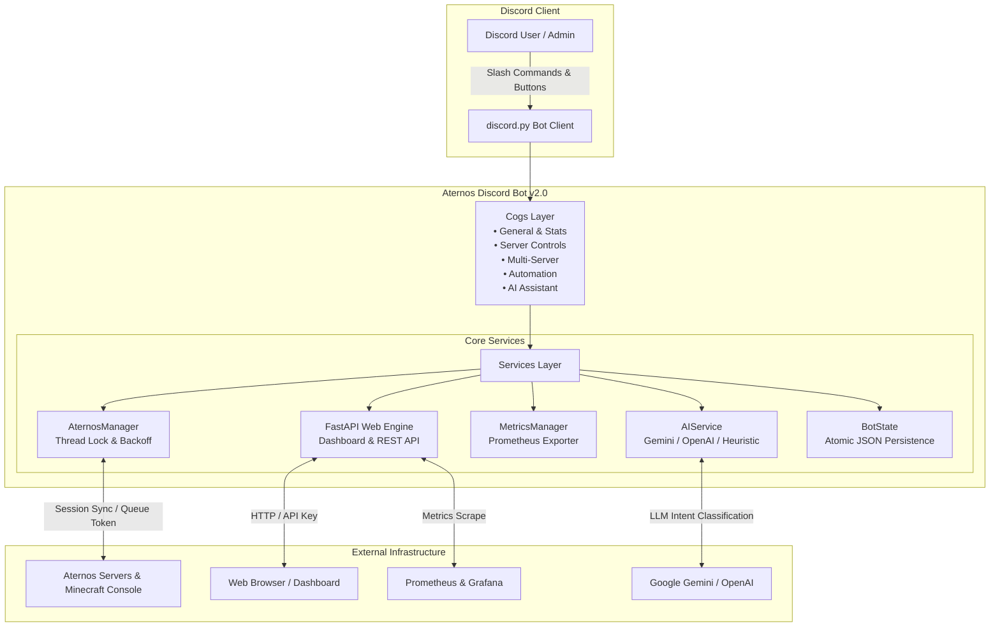

<div align="center">

# 🎮 Aternos Discord Bot v2.0
### *The Ultimate Production-Grade Management Suite for Aternos Minecraft Servers*

[](https://python.org)
[](https://github.com/Rapptz/discord.py)
[](https://fastapi.tiangolo.com)
[](https://github.com/Zerxen-dev/Aternos-Discord-Bot/pkgs/container/aternos-discord-bot)
[](tests/)
[](LICENSE)

<br/>

**Aternos Discord Bot** bridges Discord and your Aternos Minecraft servers with unprecedented power, reliability, and security. Control servers with one click, track uptime in real-time, speak to an integrated AI assistant, manage multiple servers simultaneously, and monitor everything through a sleek modern web dashboard.

[🚀 Quick Start](#-quick-start) • [✨ Key Features](#-features) • [📊 Web Dashboard](#-web-management-suite) • [🤖 AI Assistant](#-ai-natural-language-assistant) • [📸 Commands](#-command-reference) • [🏗️ Architecture](#️-architecture) • [📖 Documentation](#-documentation)

---

</div>

## 📢 The Elevator Pitch

> *"Tired of opening the browser, logging in, solving captchas, and waiting in queue just to turn on your friend group's Minecraft server? **Aternos Discord Bot v2.0** turns Discord into a complete Minecraft operations cockpit. Run `/panel` for instant control buttons, `/ask "wake up the server"` for voice or text AI triggering, track live player counts dynamically in Discord voice channel titles, and view real-time uptime analytics on your private Web Dashboard. Free, fully open-source, and containerized for zero-friction self-hosting."*

---

## ✨ Features

| Feature | Category | Description |
| :--- | :---: | :--- |
| 🎛️ **Interactive Panel (`/panel`)** | Control | One-click Start, Stop, Restart, and Status buttons with confirmation guards. |
| 📊 **Web Dashboard & REST API** | Web Suite | Responsive modern FastAPI web panel (`:8080`) with live telemetry, uptime charts & logs. |
| 🤖 **AI Assistant (`/ask`)** | Intelligence | Google Gemini & OpenAI natural language intent parser with deterministic fallback. |
| 🗂️ **Multi-Server Support** | Multi-Tenancy | Seamlessly list and switch between multiple servers (`/servers list`, `/servers select`). |
| 🟢 **Live Auto-Updating Channels** | Monitoring | Live auto-refreshing status embed + dynamic voice channel title (`🟢 4/20 Online`). |
| 🔔 **State & Player Alerts** | Notifications | Instant channel notifications with role pings (`@Minecraft`) on online, offline, joins. |
| ⏰ **Automated Scheduler** | Automation | Scheduled start/stop/restart routines with UTC timers and interactive modal creation. |
| 🤖 **Auto-Start & Auto-Stop** | Reliability | Automatically reboot on crash; automatically shut down when empty after *N* minutes. |
| 💾 **One-Click Backups** | Preservation | Create and list world backups with pagination directly from Discord. |
| 📜 **Live Console & Injection Filter**| Management | Send commands safely (`/console`) and view recent log lines (`/logs`). |
| 🛡️ **Role & Rate-Limit Security** | Security | Sliding-window command rate limiting, token sanitization, and role permission gates. |
| 📈 **Observability & Metrics** | Diagnostics | Prometheus `/metrics` endpoint, structured JSON logging, and `/stats` command. |

---

## 🏗️ Architecture



---

## 🚀 Quick Start

### ⚡ One-Liner with Docker (Recommended)

1. **Clone the repository:**
   ```bash
   git clone https://github.com/Zerxen-dev/Aternos-Discord-Bot.git
   cd Aternos-Discord-Bot
   ```

2. **Configure your credentials:**
   ```bash
   cp .env.example .env
   # Edit with your credentials
   nano .env
   ```

3. **Spin up with Docker Compose:**
   ```bash
   docker compose up -d
   ```
   Open `http://localhost:8080` to access the Web Dashboard!

---

### 🐍 Manual Installation (Linux / macOS / Windows / Termux)

```bash
# 1. Clone repository
git clone https://github.com/Zerxen-dev/Aternos-Discord-Bot.git
cd Aternos-Discord-Bot

# 2. Create virtual environment
python3 -m venv venv
source venv/bin/activate  # On Windows: venv\Scripts\activate

# 3. Install dependencies
pip install -r requirements.txt

# 4. Configure environment
cp .env.example .env
nano .env

# 5. Run the bot
python main.py
```

---

## 📊 Web Management Suite

The built-in FastAPI dashboard provides an administrative overview accessible from any desktop or mobile browser:

- **Live Heartbeat**: Real-time status badge (Online, Offline, Starting, Stopping).
- **Hardware Telemetry**: Memory allocation (RAM), port, software type, and version.
- **Uptime Bar Chart**: Historical timeline visualizing the last 120 polling intervals.
- **Direct Controls**: Secure Start, Stop, and Restart triggers.
- **Live Console Logs**: Read-only log viewer for inspecting crashes or server activity.

Access the dashboard at `http://your-host:8080/?key=YOUR_WEB_API_KEY`.  
See the [Web Dashboard Guide](docs/web-dashboard.md) for full REST API details.

---

## 🤖 AI Natural Language Assistant

Ask questions conversationally with `/ask query:<text>`:

```
/ask query:Is anyone online right now?
> 🔍 Checking who is currently playing on the server.
> 👥 Online Players: Alex, Steve (2/20)

/ask query:Start up the server please
> ⏳ Triggering Minecraft server startup routine...
```

Supports **Google Gemini 1.5**, **OpenAI GPT-4o-mini**, and a **zero-dependency deterministic offline NLP engine**. See the [AI Assistant Guide](docs/ai-assistant.md).

---

## 📸 Command Reference

### Server Operations
- `/panel` — Display the interactive control panel with Start, Stop, Restart & Refresh buttons.
- `/start` — Start the Minecraft server.
- `/stop` — Safely stop the server with a confirmation prompt.
- `/restart` — Reboot the server with confirmation.
- `/status` — View real-time server status, player counts, and connection address.
- `/info` — Detailed specs (RAM, software, edition, port, motd).
- `/stats` — Bot runtime statistics (latency, uptime, guilds, memory).

### Multi-Server Operations
- `/servers list` — Display all Minecraft servers under your Aternos account.
- `/servers select identifier:<index|subdomain>` — Switch active server dynamically.

### AI Commands
- `/ask query:<text>` — Natural language command execution via Gemini/OpenAI/local NLP.

### Automation & Scheduling
- `/statuschannel set` — Configure live auto-updating status embed & dynamic voice channel name.
- `/statuschannel remove` — Disable live status channel updates.
- `/alerts set` — Configure alert channel, role ping (`@Minecraft`), and notification triggers.
- `/alerts remove` — Disable alerts.
- `/schedule add` — Schedule automated start/stop timers via slash command.
- `/schedule modal` — Interactive modal dialog for configuring scheduled timers.
- `/schedule list` — View all scheduled timers.
- `/schedule remove id:<int>` — Delete a scheduled timer.
- `/autostart enabled:<bool>` — Enable/disable automatic crash/offline restarts.
- `/autostop enabled:<bool> minutes:<int>` — Enable/disable automatic shutdown on empty server.

### Server Administration
- `/console command:<text>` — Safely dispatch commands to Minecraft console (sanitized & rate-limited).
- `/backup create` — Create an instant Aternos world backup.
- `/backup list` — Browse existing world backups with interactive pagination.
- `/whitelist <list|add|remove>` — Manage whitelisted players with pagination.
- `/op <list|add|remove>` — Manage server operators.
- `/ban <list|add|remove>` — Manage banned players.
- `/properties` — View live server properties.
- `/setproperty` — Update server settings with interactive Discord Modals.

---

## 🛡️ Security & Reliability

- **Safe Atomic State**: State saves use write-to-temp and atomic `os.replace` to prevent corrupted JSON configurations during sudden host reboots.
- **Command Sanitization**: Strict input validation strips terminal control characters, shell-chaining operators (`&&`, `;`, `||`), and length violations.
- **Sliding-Window Rate Limiting**: Anti-spam protection prevents accidental or malicious command flooding.
- **Role Permission Guards**: Administrative actions can be restricted to specific Discord roles (`ADMIN_ROLE_IDS`) or user IDs (`ADMIN_USER_IDS`).
- **Prometheus Metrics**: Export telemetry at `/metrics` for monitoring via Grafana or Datadog.

---

## 📖 Documentation

- [VPS Deployment & Reverse Proxy Setup](docs/vps-deployment.md)
- [Aternos Credentials & Session Security](docs/aternos-credentials.md)
- [Web Dashboard & REST API Reference](docs/web-dashboard.md)
- [Multi-Server Setup](docs/multi-server.md)
- [AI Assistant Configuration](docs/ai-assistant.md)

---

## 🤝 Contributing

Contributions make the open-source community thrive! Please see [CONTRIBUTING.md](CONTRIBUTING.md) and [CODE_OF_CONDUCT.md](CODE_OF_CONDUCT.md) for contribution guidelines.

---

## 📄 License

Distributed under the MIT License. See [LICENSE](LICENSE) for more information.

<div align="center">
  <b>Built with ❤️ for Minecraft server operators worldwide</b>
</div>
